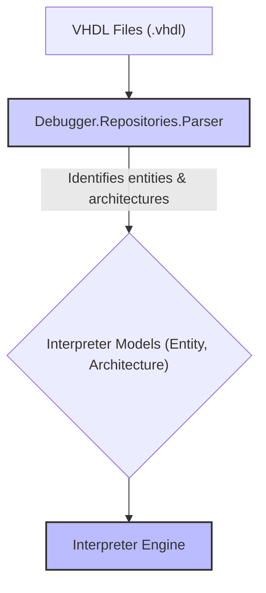
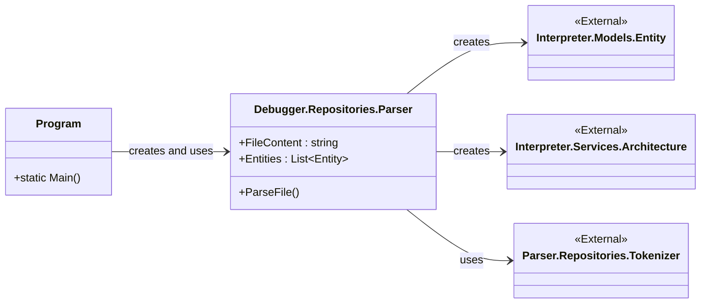
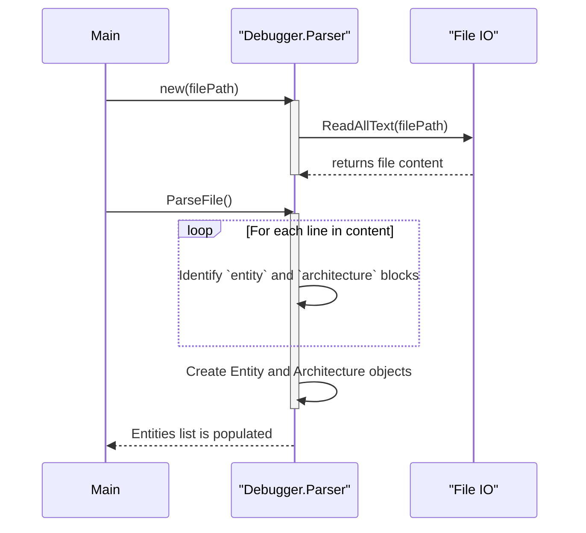
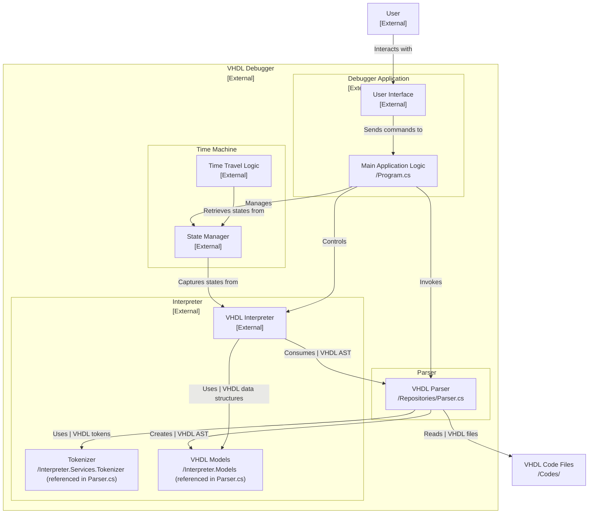

# Debugger Module

## Project: Kmila-9s

This module is a core component of **Kmila-9s**, a project officially titled "Aplicación Multiplataforma para el Aprendizaje y Depuración de Código VHDL sin Requerimiento de Hardware Físico" (Multiplatform Application for Learning and Debugging VHDL Code without Requiring Physical Hardware).

**Author:** Ulrich Tamayo Daniel
**Email:** dulricht1700@alumno.ipn.mx
**Email 2:** danielulrichtamayo@gmail.com
**Version:** 0.6.0
**Last Updated:** December 13, 2025

---

## 1. Project Overview

The primary goal of this project is to develop a free, open-source, and multiplatform desktop application for the interactive debugging of VHDL code. The application aims to facilitate the learning of digital design by providing a unified environment for simulation and real-time visualization of digital signals, clock cycles, and port states, completely eliminating the need for physical hardware like FPGAs.

### Key Motivations
*   **Accessibility:** Overcoming the financial barrier of expensive FPGA boards and proprietary software licenses.
*   **Pedagogical Improvement:** Offering an intuitive, integrated graphical interface that simplifies the debugging process, unlike the fragmented command-line workflows of tools like GHDL and GTKWave.
*   **Flexibility:** Providing a self-contained application that runs locally on multiple operating systems (Windows, macOS, Linux, Android, iOS) without requiring an internet connection.

This project is built using .NET and MAUI, ensuring a modern and maintainable codebase with broad platform support.

## 2. The Debugger Module

This specific module, the **Debugger**, acts as the central orchestrator for the VHDL simulation process. It is responsible for taking raw VHDL source files, preparing them for execution, and (ultimately) managing the interactive debugging session. It integrates the `Parser`, `Interpreter`, and `TimeMachine` modules to create a cohesive simulation environment.

### Core Responsibilities
*   **VHDL File Processing:** Reading raw `.vhdl` source files from the filesystem.
*   **Structural Analysis:** Parsing the file content to identify top-level `entity` and `architecture` blocks.
*   **Data Model Hydration:** Constructing the in-memory C# objects (like `Entity` and `Architecture` from the `Interpreter` module) that are required for the simulation engine to work.
*   **Simulation Orchestration:** (Future) Integrating with the `Interpreter` and `TimeMachine` to control the step-by-step execution of the VHDL code.
*   **State Inspection:** (Future) Providing the hooks needed to inspect signal and variable states, manage breakpoints, and visualize data.

## 3. Architecture of the Debugger Module

The Debugger module is designed as a high-level coordinator that prepares data for the other core components of the Kmila-9s project.

### Key Components

*   **`Program.cs`**: The main entry point for the application. It is currently responsible for scanning a directory of VHDL files and initiating the parsing process for each one.

*   **`Repositories/Parser.cs`**: A specialized file processor that acts as a bridge between VHDL source code and the `Interpreter` module. It reads the content of a `.vhdl` file, uses string manipulation to identify the boundaries of `entity` and `architecture` blocks, and uses this information to instantiate the `Entity` and `Architecture` data models required by the interpreter.

### Core Data Models

This module primarily uses and creates data models defined in the **Interpreter Module**, including:
*   **`Interpreter.Models.Entity`**: Represents a VHDL entity, including its ports and generics.
*   **`Interpreter.Services.Architecture`**: Represents a VHDL architecture, containing the logic to be simulated.

## 4. How to Use This Module

To use the debugger's parsing functionality, you provide the path to a VHDL file to the `Debugger.Repositories.Parser`. The `ParseFile()` method then processes the file and populates its `Entities` list.

```csharp
using Debugger.Repositories;
using System;

// This example demonstrates the current file processing capability.
var files = Directory.GetFiles("Codes");
foreach (var file in files)
{
    try
    {
        // 1. Initialize the Debugger's Parser with a file path.
        Parser vhdlFileParser = new(file);

        // 2. Process the file to identify entities and architectures.
        vhdlFileParser.ParseFile();

        // 3. The parsed entities are now available for the Interpreter.
        Console.WriteLine($"File: {file}, Entities found: {vhdlFileParser.Entities.Count}");
    }
    catch (Exception ex)
    {
        Console.WriteLine($"An error occurred while parsing {file}: {ex.Message}");
    }
}
```

## 5. Dependencies

This module integrates other key parts of the Kmila-9s project and relies on:
*   **`Interpreter` Module**: For its core data models (`Entity`, `Architecture`).
*   **`TimeMachine` Module**: (For future integration) To control the simulation timeline.
*   **`Parser` Module**: For the low-level `Tokenizer`.
*   **`Microsoft.Extensions.Logging`**: For logging and diagnostics.

## 6. Debugger Flow and Class Relationships

The following diagrams illustrate the current data flow and class relationships for the file processing stage.

### 6.1. High-Level Data Flow

This diagram shows how the Debugger processes VHDL files to prepare them for the interpreter.



### 6.2. Detailed Class Diagram

This diagram shows the key classes and their relationship with other modules.



### 6.3. Sequence Diagram: Parsing a File

This diagram shows the runtime interactions when `Program.cs` processes a single VHDL file.



### 6.4. Module Diagram


## 7. Current Limitations

The following limitations exist in the current implementation:

*   **Tokenizer Not Actively Used:** The `Tokenizer` class from the Parser module is instantiated in `ParseFile()` but not actively used. This is reserved for future enhancement to provide more robust parsing.
*   **No Multiline Comment Handling:** The parser uses simple line-by-line string matching and does not handle VHDL multiline comments (`/* ... */`).
*   **Simple Parsing Approach:** Structure detection relies on string pattern matching rather than true AST-based parsing.
*   **Single Entity-Architecture Assumption:** The parser expects architectures to reference entities that were declared earlier in the same file.

## 8. Changelog

### Version 0.6.0 (2025-12-13)

#### Documentation Improvements

*   **Program.cs**: Added comprehensive XML documentation including:
    *   Class-level summary explaining the test harness purpose
    *   Method documentation with processing steps
    *   Expected directory structure diagram
    *   Exception documentation

*   **Repositories/Parser.cs**: Added complete XML documentation including:
    *   Class-level documentation explaining the state machine algorithm
    *   Detailed remarks about parsing limitations
    *   Property documentation for `FileContent` and `Entities`
    *   Private field documentation for `_excludedEnds`
    *   Constructor and method documentation with step-by-step processing details
    *   Inline comments explaining state transitions and entity/architecture association

*   **README.md**: Added version information, last updated date, current limitations section, and this changelog

---
*Last Updated: December 13, 2025*
