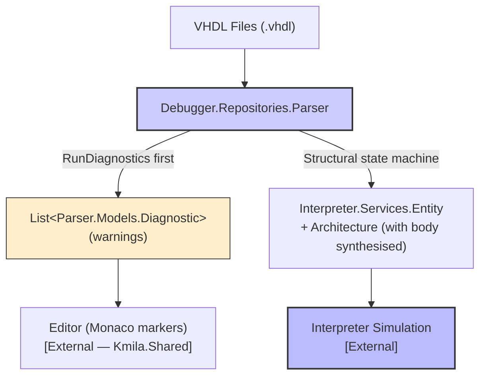
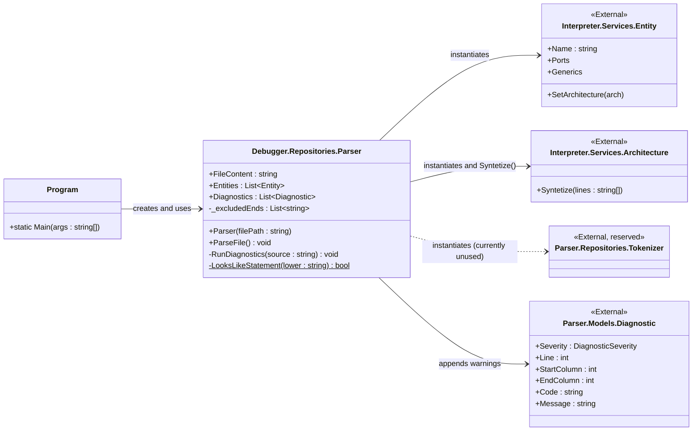
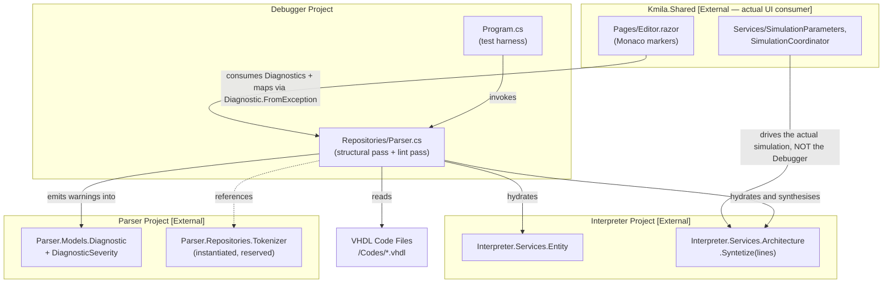
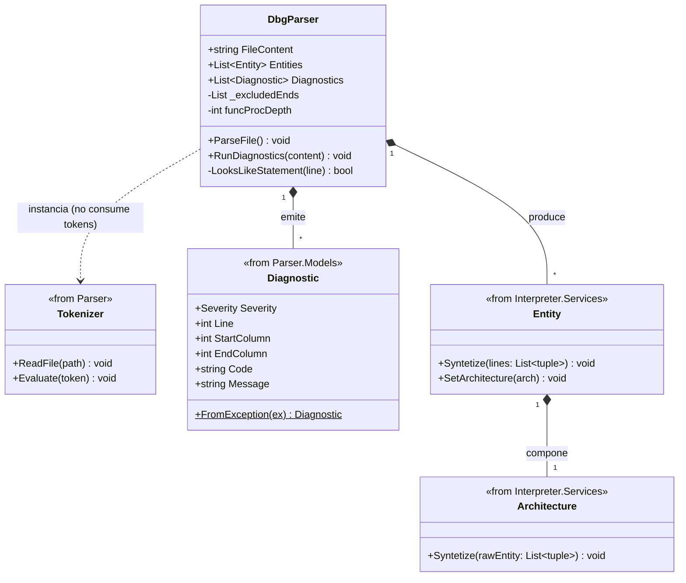
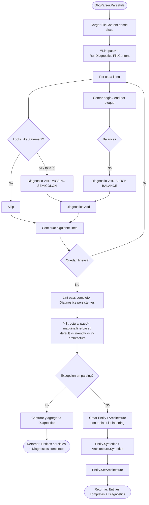

# Debugger Module

## Project: Kmila-9s

This module is a core component of **Kmila-9s**, a project officially titled "Aplicación Multiplataforma para el Aprendizaje y Depuración de Código VHDL sin Requerimiento de Hardware Físico" (Multiplatform Application for Learning and Debugging VHDL Code without Requiring Physical Hardware).

**Author:** Ulrich Tamayo Daniel
**Email:** dulricht1700@alumno.ipn.mx
**Email 2:** danielulrichtamayo@gmail.com
**Version:** 1.14.1
**Last Updated:** August 3, 2026

---

## 1. Project Overview

The primary goal of this project is to develop a free, open-source, and multiplatform desktop application for the interactive debugging of VHDL code. The application aims to facilitate the learning of digital design by providing a unified environment for simulation and real-time visualization of digital signals, clock cycles, and port states, completely eliminating the need for physical hardware like FPGAs.

### Key Motivations
*   **Accessibility:** Overcoming the financial barrier of expensive FPGA boards and proprietary software licenses.
*   **Pedagogical Improvement:** Offering an intuitive, integrated graphical interface that simplifies the debugging process, unlike the fragmented command-line workflows of tools like GHDL and GTKWave.
*   **Flexibility:** Providing a self-contained application that runs locally on multiple operating systems (Windows, macOS, Linux, Android, iOS) without requiring an internet connection.

This project is built using .NET and MAUI, ensuring a modern and maintainable codebase with broad platform support.

## 2. The Debugger Module

This specific module, the **Debugger**, is a thin façade that bridges raw VHDL source files with the `Interpreter` data models. In the current state of the codebase it does **two** jobs:

1.  Run a fast structural pass to extract top-level `entity` / `architecture` blocks and hydrate `Interpreter.Services.Entity` / `Interpreter.Services.Architecture` objects from them.
2.  Run a lightweight source-level **lint pass** (`RunDiagnostics`) that emits structured `Parser.Models.Diagnostic` entries (missing `;`, `begin` / `end` imbalance) for the editor surface to render as Monaco markers — *before* the structural parse runs, so warnings still appear on broken sources.

It does **not** orchestrate the live simulation or manage breakpoints; those responsibilities live in `Kmila.Shared.Services` (`SimulationParameters`, `SimulationCoordinator`, etc.) and the `Interpreter` simulation runner. `Debugger.csproj` still `ProjectReference`s both `Interpreter` and `TimeMachine` because the structural pass hands the results back to `Interpreter` types and downstream consumers (Kmila.Shared) rely on TimeMachine snapshots being reachable from the same assembly graph — but nothing inside `Debugger` itself calls into TimeMachine. Earlier README revisions described a wider "central orchestrator" role that never materialised here; this module stayed pre-processing-only.

### Core Responsibilities
*   **VHDL File Processing:** Reading raw `.vhdl` source files from the filesystem (`File.ReadAllText` in the constructor).
*   **Structural Analysis:** Walking the file line-by-line with a 3-state state machine (default → entity → architecture) to identify top-level blocks.
*   **Data Model Hydration:** Constructing `Entity` and `Architecture` objects (from the `Interpreter` module) and attaching the architecture to its declaring entity via `entity.SetArchitecture(arch)`.
*   **Source-level Diagnostics:** Collecting non-fatal warnings about missing semicolons and `begin` / `end` balance in `Diagnostics`, suitable for direct mapping to Monaco's `setModelMarkers`.
*   **Resilient parsing:** The lint pass runs *before* the structural pass so that even if the structural pass throws, the editor still shows diagnostics for the user to act on.

## 3. Architecture of the Debugger Module

The Debugger module is designed as a high-level coordinator that prepares data for the other core components of the Kmila-9s project.

### Key Components

*   **`Program.cs`**: A small console test harness that scans the `Codes/` directory for `.vhdl` files and parses each one, printing the entity count it found per file. Useful for smoke-testing the parser bridge in isolation.

*   **`Repositories/Parser.cs`**: The only real class in the module. Reads a `.vhdl` file in the constructor, exposes:
    *   `string FileContent { get; private set; }` — raw file text.
    *   `List<Entity> Entities { get; private set; }` — entities discovered (with their architectures already attached after parsing).
    *   `List<Parser.Models.Diagnostic> Diagnostics { get; private set; }` — structured warnings produced by the lint pass.
    *   `void ParseFile()` — runs the lint pass first, then walks the file with the 3-state state machine to populate `Entities`. Forwards to `ParseFile(CancellationToken.None)`.
    *   `void ParseFile(CancellationToken cancellationToken)` — cancellable overload added in Session 22 pass 4 (F-G-08). Threads the token into both `entity.Syntetize(rawEntity, ct)` and `arch.Syntetize(rawEntity, ct)` so the wall-timeout hook (`KMILA_SIM_WALL_TIMEOUT_MS` in `HeadlessSimulator`) can actually interrupt a stuck synthesis descent instead of waiting for the HTTP client to disconnect. Prior to pass 4 the parser had no cancellation surface.
    *   `private void RunDiagnostics(string source)` — the lint pass itself.
    *   `private static bool LooksLikeStatement(string lower)` — heuristic that decides which lines should require a trailing `;`.

### Core Data Models

This module **uses** data models defined in two upstream modules:

*   **`Interpreter.Services.Entity`** — represents a VHDL entity, including its ports and generics.
*   **`Interpreter.Services.Architecture`** — represents a VHDL architecture; `Syntetize(string[] lines)` is invoked here once the architecture body has been collected.
*   **`Parser.Models.Diagnostic`** + **`Parser.Models.DiagnosticSeverity`** — structured diagnostic record used to surface lint findings to the Editor page. The Debugger never instantiates `Parser.Models.ParserException` directly; that is the job of the upstream `Parser` project, but the Editor maps both into the same diagnostic stream.

### Lint diagnostics emitted

| Code | Severity | Trigger |
|------|----------|---------|
| `VHD-MISSING-SEMICOLON` | Warning | Line looks like a statement (`<=`, `:=`, `=>`, or starts with `library`/`use`/`signal`/`variable`/`constant`) but does not end with `;`, `,`, `is`, `then`, `else`, `loop`, `begin`, `generate`, `(`, or `)`. |
| `VHD-BLOCK-BALANCE` | Warning | Total `begin` keyword count does not match total `end` keyword count across the whole file. Reported once at the last line. |

Errors thrown by the upstream `Parser` project propagate as `Parser.Models.ParserException`; callers (e.g. the Editor page) typically convert them with `Diagnostic.FromException(...)` so they appear in the same Monaco marker stream.

## 4. How to Use This Module

To use the debugger's parsing functionality, you provide the path to a VHDL file to the `Debugger.Repositories.Parser`. The `ParseFile()` method then processes the file, runs the lint pass, and populates the `Entities` and `Diagnostics` lists.

```csharp
using Debugger.Repositories;
using System;

// This example demonstrates the current file processing capability.
var files = Directory.GetFiles("Codes");
foreach (var file in files)
{
    try
    {
        // 1. Initialize the Debugger's Parser with a file path.
        Parser vhdlFileParser = new(file);

        // 2. Process the file to identify entities and architectures.
        //    The lint pass runs first, even if the structural pass later throws.
        vhdlFileParser.ParseFile();

        // 3. The parsed entities are now available for the Interpreter.
        Console.WriteLine($"File: {file}, Entities found: {vhdlFileParser.Entities.Count}");

        // 4. Surface non-fatal lint warnings (mirrors what the Editor page does
        //    when wiring Monaco's setModelMarkers).
        foreach (var d in vhdlFileParser.Diagnostics)
        {
            Console.WriteLine($"  [{d.Severity}] L{d.Line}:{d.StartColumn} {d.Code} — {d.Message}");
        }
    }
    catch (Exception ex)
    {
        // Structural failures (e.g. "Entity not found") propagate. The editor
        // surface typically catches these and maps them to error-level
        // diagnostics via Diagnostic.FromException(...).
        Console.WriteLine($"An error occurred while parsing {file}: {ex.Message}");
    }
}
```

## 5. Dependencies

This module integrates other key parts of the Kmila-9s project and relies on:
*   **`Interpreter` Module**: For its data models (`Entity`, `Architecture`) and the architecture-synthesis entry point (`Architecture.Syntetize`).
*   **`Parser` Module**: For two things — the `Tokenizer` (currently instantiated but reserved for future structural rewrites) and the `Parser.Models.Diagnostic` / `Parser.Models.DiagnosticSeverity` types used by the lint pass.
*   **.NET 9 BCL only** otherwise — no `Microsoft.Extensions.Logging`, no `TimeMachine` dependency. The Debugger is a pre-processing layer; the live simulation is driven from the `Kmila.Shared` Editor stack, not from this project.

## 6. Debugger Flow and Class Relationships

The following diagrams illustrate the **actual** data flow and class relationships of the module as it stands today. Earlier revisions of this README depicted a "State Manager / Time Travel Logic / Simulation Orchestrator" subsystem inside the Debugger that never existed in the source — it has been removed.

### 6.1. High-Level Data Flow



### 6.2. Detailed Class Diagram



### 6.3. Sequence Diagram: Parsing a File

```mermaid
sequenceDiagram
    participant Main
    participant DbgParser as "Debugger.Repositories.Parser"
    participant FileIO as "File IO"
    participant Arch as "Interpreter.Services.Architecture"

    Main->>DbgParser: new(filePath)
    activate DbgParser
    DbgParser->>FileIO: ReadAllText(filePath)
    FileIO-->>DbgParser: file content
    deactivate DbgParser

    Main->>DbgParser: ParseFile()
    activate DbgParser
    DbgParser->>DbgParser: RunDiagnostics(FileContent)
    Note right of DbgParser: emits VHD-MISSING-SEMICOLON,<br/>VHD-BLOCK-BALANCE warnings

    loop For each non-empty line
        DbgParser->>DbgParser: Detect entity / architecture starts
        DbgParser->>DbgParser: Collect lines until "end ...;"
    end

    DbgParser->>DbgParser: new Entity(rawLines)
    DbgParser->>Arch: new Architecture(ports, generics)
    DbgParser->>Arch: Syntetize(rawLines)
    DbgParser->>DbgParser: entity.SetArchitecture(arch)
    deactivate DbgParser
    DbgParser-->>Main: Entities + Diagnostics populated
```

### 6.4. Module Diagram



## 7. Current Limitations

The following limitations exist in the current implementation:

*   **Tokenizer Not Actively Used:** The `Tokenizer` class from the Parser module is instantiated inside `ParseFile()` but its tokens are not consumed. The structural pass still uses line-level string matching. Reserved for a future rewrite.
*   **VHDL Comments:** The lint pass strips `--` line comments before analysis, but multiline / block comment forms are not specially handled (VHDL itself does not have `/* ... */`).
*   **Simple Parsing Approach:** Structure detection relies on `comparer.StartsWith("entity")` / `"architecture"` — no real AST is built in this project. AST-style parsing happens in the upstream `Parser` project.
*   **Single Entity-Architecture Assumption:** Architectures are matched to entities declared *earlier* in the same file, by name. Out-of-order declarations and cross-file lookups raise `Exception("Entity not found")`.
*   **Single Diagnostic Pass:** `RunDiagnostics` only emits two codes today (`VHD-MISSING-SEMICOLON`, `VHD-BLOCK-BALANCE`). Richer rules (port direction, type mismatches, unused signals) live in the simulation pipeline, not here.
*   **No Simulation, No TimeMachine:** Despite the project name, this module does not run a simulation or talk to `TimeMachine`. Live debugging is driven from `Kmila.Shared.Services` against the `Interpreter`.
*   **Stray `test_output.vcd` in the module root:** A `Debugger/test_output.vcd` file sits at the module root. It is a **leftover artifact, not produced by this module** (which runs no simulation and emits no VCD — see above). Treat it as safe to ignore/remove during cleanup; it plays no part in the Debugger's pre-processing pass.

## 7.bis. Audit diagrams (2026-05-09)

These diagrams complement sections 6.1–6.4. They were added during the cross-module
audit because the existing TT1 diagrams either misrepresented this module
(`fig_5_2_c4_contenedores` claimed Debugger delegates tokenization to Parser and
coordinates with TimeMachine — neither is true) or did not depict the lint-first
pipeline at all. Sources also live in `Documentacion/TT1/diagrams/`.

### `fig_5_5_12_clases_debugger` — Debugger class detail



### `fig_5_11_12_act_debugger_lint_resilience` — Lint-first pipeline



## 8. Changelog

### Version 1.14.1 (2026-05-01)

#### Documentation Re-alignment

*   **Section 2 / "Core Responsibilities"**: Removed the long-standing claim that the Debugger module orchestrates `Parser` + `Interpreter` + `TimeMachine`. The current code is pre-processing only (structural extraction + lint diagnostics). Live simulation has always been driven by `Kmila.Shared.Services`.
*   **Section 3 / Key Components**: Added the `Diagnostics` property, the `RunDiagnostics(string)` lint pass, and the `LooksLikeStatement(string)` helper. Added an explicit "Lint diagnostics emitted" subsection enumerating the two codes (`VHD-MISSING-SEMICOLON`, `VHD-BLOCK-BALANCE`).
*   **Section 4 / Usage example**: Updated the snippet to surface `Diagnostics` (the property the editor actually consumes), and clarified that `Parser.Models.ParserException` is mapped via `Diagnostic.FromException(...)` upstream.
*   **Section 5 / Dependencies**: Removed the bogus `TimeMachine` and `Microsoft.Extensions.Logging` dependencies — the Debugger references `Interpreter` and `Parser` only, on plain .NET 9.
*   **Section 6 / Diagrams** — all four regenerated:
    *   §6.1 now shows the lint pass running before the structural pass and feeding the editor independently.
    *   §6.2 lists the real public surface (`Diagnostics`, `_excludedEnds`, the `RunDiagnostics`/`LooksLikeStatement` helpers) and adds the `Parser.Models.Diagnostic` external class.
    *   §6.3 inserts the `RunDiagnostics` step and the call to `Architecture.Syntetize`.
    *   §6.4 removed the fictional "State Manager" and "Time Travel Logic" boundaries and replaced them with the real consumer surface (`Kmila.Shared.Pages.Editor` and `SimulationCoordinator`).
*   **Section 7 / Limitations**: Refined the comment-handling note (line comments are stripped, no block-comment form exists in VHDL anyway), added "Single Diagnostic Pass" + "No Simulation, No TimeMachine" to set correct expectations.

---

### Version 0.6.1 (2026-02-21)

#### Documentation Fixes

*   **README.md**: Fixed module diagram to correctly reference `Parser.Repositories.Tokenizer` instead of `Interpreter.Services.Tokenizer`
*   **README.md**: Updated VHDL Models node to reference both `Interpreter.Models` and `Interpreter.Services` namespaces (Entity is in Services, models in Models)

---

### Version 0.6.0 (2025-12-13)

#### Documentation Improvements

*   **Program.cs**: Added comprehensive XML documentation including:
    *   Class-level summary explaining the test harness purpose
    *   Method documentation with processing steps
    *   Expected directory structure diagram
    *   Exception documentation

*   **Repositories/Parser.cs**: Added complete XML documentation including:
    *   Class-level documentation explaining the state machine algorithm
    *   Detailed remarks about parsing limitations
    *   Property documentation for `FileContent` and `Entities`
    *   Private field documentation for `_excludedEnds`
    *   Constructor and method documentation with step-by-step processing details
    *   Inline comments explaining state transitions and entity/architecture association

*   **README.md**: Added version information, last updated date, current limitations section, and this changelog

---

### Version 1.14.0 (2026-04-19)

*   **`Repositories/Parser.cs` — diagnostics collection.** Added a
    `Diagnostics` property (typed as `global::Parser.Models.Diagnostic` to
    dodge the namespace collision between this file's `Parser` class and
    the `Parser` project) plus a lightweight `RunDiagnostics(source)` lint
    pass that catches missing `;` at statement ends and `begin` / `end`
    imbalance before falling through to the full parser. Feeds directly
    into Monaco's `setModelMarkers` from the editor.
*   `ParserException` instances are also coerced via
    `Diagnostic.FromException(...)` into the same list, so surfacing in
    the editor is uniform regardless of whether the error came from the
    lint pass or the parser throwing.
*   **Build hygiene** — `<NoWarn>` added for XML-doc ripple so the
    Debugger project builds cleanly alongside the rest of the solution.

---

## What's new in v1.15 (2 May 2026)

- **Source-line-accurate diagnostics (#21).** `ParseFile` now collects each non-blank line as `(lineIndex, text)` and feeds those tuples to the new `Entity.Syntetize(IReadOnlyList<(int, string)>)` / `Architecture.Syntetize(IReadOnlyList<(int, string)>)` overloads, which call `Tokenizer.TokenizeLineAt`. Error messages reference the user's actual file lines instead of the tokenizer's internal call counter.
- **Lint diagnostics surface even on parse failure.** `Program.Main` wraps `ParseFile()` in try/catch and prints every `Diagnostic` (e.g. `VHD-MISSING-SEMICOLON`, `VHD-BLOCK-BALANCE`) before re-emitting the structural error. Previously a throw masked all upstream lint output.
- **Architecture-slicing bug fixed.** The substring-match fallback `comparer.Contains(currentArchName.ToLower())` no longer mistakes `end maxv;` for arch end of `architecture A of …`. Exact-name matching only, plus a control-flow keyword exclusion list (`end if/loop/case/for/while/generate/record`).
- **Workstation GC** enabled at the project level (#7).

Full release notes: [`../Documentacion/CHANGELOG_v1.15.md`](../Documentacion/CHANGELOG_v1.15.md).

---
*Last Updated: 2026-08-03*
